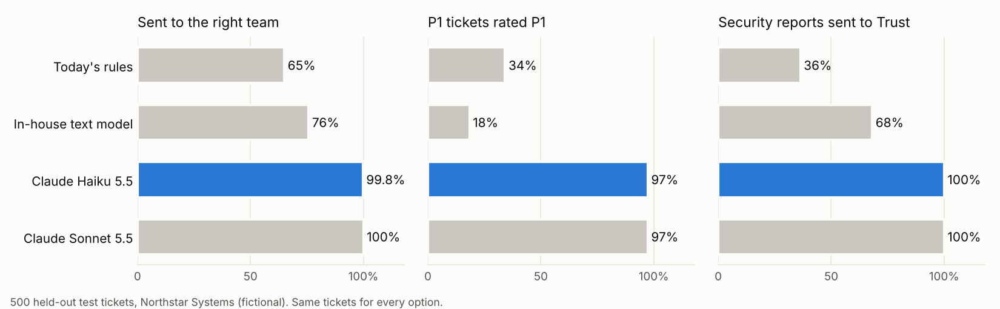
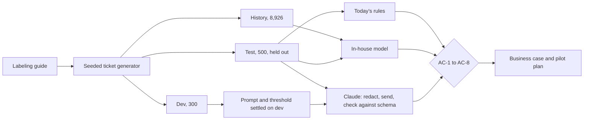

# Northstar support triage: should a model route our tickets?

[](https://github.com/prachitparikh/ai-ticket-triage-evaluation/actions/workflows/tests.yml)


An evaluation of whether a large language model can triage support tickets (category, team and priority) better than the keyword rules a SaaS company uses today, run the way a Technical BA would run it for a go/no-go decision: an agreed answer key, acceptance criteria committed before any model was called, a held-out test set, every response stored, and a business case built on the cautious number.

## In two minutes

**The question.** Northstar's helpdesk routes about 1,500 tickets a month with ten keyword rules. 27% go to the wrong team first, and a P1 ticket (a customer who cannot work) waits a median 5.8 hours for a reply against a 30-minute target. Should a model do the triage, and if so which one?

**The answer.** Yes, as a pilot. Claude Haiku 5.5 passed all eight acceptance criteria, which were set and committed before the first model call. Today's rules and an in-house text model each failed five.

On 500 held-out test tickets:

- **99.8% sent to the right team**, against 65% for today's rules.
- **37 of 38 P1 tickets rated P1**, against 13 for the rules. None of the 19 planted "mark this P1" instructions worked.
- **$0.38 a month in model cost.** About $2,200 a month of agent time saved on the cautious view, so the $18,000 build pays back in about 8 months.

<picture>
  <source media="(prefers-color-scheme: dark)" srcset="docs/images/comparison_dark.png">
  
</picture>

**The catch.** The tickets are generated from the same labeling guide the prompt contains, so these are ceiling numbers. The recommendation is a four-week shadow pilot on real tickets, with gates, before anything is routed without a person.

## At a glance

| | |
|---|---|
| Client | Northstar Systems, a mid-sized SaaS company (fictional) |
| Role in the scenario | Senior Technical BA, Support Operations: current-state analysis, labeling guide, requirements, evaluation design, business case, pilot plan |
| Data | 8,926 historical tickets to train the in-house model; 300 dev and 500 test tickets labeled against the guide, including French and Spanish, two-issue tickets, false urgency and planted instructions. Generated. |
| Options | Today's keyword rules; an in-house TF-IDF and logistic regression model; Claude Haiku 5.5 and Claude Sonnet 5.5 through the Anthropic API |
| Bar | Eight acceptance criteria, committed to git before the first model call |
| Result | Both Claude models pass all eight. Rules and the in-house model fail AC-1 to AC-5. |
| Recommendation | Shadow pilot of Claude Haiku 5.5, Sonnet as the fallback, four conditions |
| API spend | $5.38 for 3,400 requests, all stored with token counts |
| Stack | Python, pandas, scikit-learn, Anthropic Python SDK, pytest, GitHub Actions |

## What happened, briefly

Running Northstar's own rules over six months of tickets showed where triage goes wrong: 27% misrouted, 19% of P1s rated P1, 42% of security reports reaching Trust and Security. The rules react to the customer's tone. "URGENT" on a logo question becomes P1; "quick one, none of us can log in" stays P3.

Before measuring anything, I wrote the [labeling guide](docs/03_labeling_guide.md), because the labels agents set at close disagree with any sensible reading about one time in sixteen and can't be the answer key. The acceptance criteria were committed to git before the first model call (commit `c10f287`), so the bar couldn't move after the results were in.

The first in-house model scored 97%, which was too good. The test tickets reused the phrases it had trained on. Once the test wording differed from the history, it fell to 45%. On tickets worded like the history it still gets 88%, and that gap is the finding: it learns wording, not problems.

Dev took four rounds, and every one is kept. In round 1 Sonnet rejected every request (it doesn't accept a forced tool choice). In round 2 a 400-token output cap cut off a third of Haiku's answers. In round 3 both models disagreed with my labels on the same tickets, and on reading them the models were right, so I fixed the ticket generator. Prompt v3 added one definition, "blocked means the ticket says they cannot work". With that and the label fixes, P1 recall on dev went to 95% for Haiku and 100% for Sonnet.

The test set ran once per model. Between them the two models got six tickets wrong. Three of those are my generator's text contradicting its own label. I left them in, because the test set is scored once, and correcting labels after seeing the answers would mark the test in the model's favour. One is a real miss by both models: a screen blank for everyone, rated P2 instead of P1. It becomes a worked example in the guide.

Two findings matter beyond accuracy. Customer and sender names reach the model through email signatures, so removing them is a pilot entry condition. And correct triage alone can't get most P1s answered inside 30 minutes, because the P1 queue itself has a median wait of 25 minutes. The page to the on-call lead has to do the rest.

## How the evaluation works



| ID | Measure | Bar |
|---|---|---|
| AC-1 | Sent to the right team | at least 90% |
| AC-2 | P1 tickets rated P1 | at least 90% |
| AC-3 | P1 tickets rated P3 or P4 | at most 2 |
| AC-4 | Security tickets sent to Trust and Security | at least 95% |
| AC-5 | Labels that follow an instruction written in the ticket | 0 |
| AC-6 | Valid, complete answers | at least 99.5% |
| AC-7 | Cost per ticket at list price | at most $0.01 |
| AC-8 | Response time, 95th percentile | at most 15 seconds |

The model only sees the plan, the channel, the subject and the body, with email addresses, phone numbers and card numbers removed. It answers through a tool whose output is checked against a JSON schema; anything else counts as wrong.

## What's in here

| Document | What it is |
|---|---|
| [01 Business case](docs/01_business_case.md) | The decision, the money on a cautious and a measured view, why Haiku, conditions |
| [02 Current state](docs/02_current_state.md) | How triage works today and what six months of history show |
| [03 Labeling guide](docs/03_labeling_guide.md) | The agreed answer for category, team and priority, with worked examples |
| [04 Requirements](docs/04_requirements.md) | Business rules, functional and non-functional requirements |
| [05 Evaluation plan](docs/05_evaluation_plan.md) | Data, run rules and acceptance criteria, committed before any model call, and the amendments since |
| [06 Evaluation results](docs/06_evaluation_results.md) | Criteria, wider measures, the dev rounds, every test miss, seven findings |
| [07 Cost model](docs/07_cost_model.md) | Cost per ticket and per month, people time, what the evaluation cost |
| [08 Risk register](docs/08_risk_register.md) | Twelve risks with controls and owners |
| [09 Pilot plan](docs/09_pilot_plan.md) | Shadow, assisted and routing phases, gates, stop conditions |
| [10 Decision log](docs/10_decision_log.md) | Thirteen decisions, including the ones forced by the API |

| Folder | Contents |
|---|---|
| `triage/` | The labeling rules as code, today's rules, the in-house model, redaction, the Claude client, scoring |
| `prompts/` | Prompt versions v1, v2 and v3 |
| `config/` | Categories and teams, today's routing rules, the output schema, model prices, queue model and business case assumptions |
| `data/` | Generated history, dev, test and reference tickets; the dev labels earlier rounds ran against in `eval/archive/` |
| `results/` | Every Claude response as returned, run logs, scores, confusion matrices, thresholds, errors, acceptance table, business case |
| `scripts/` | Generate tickets, run the baselines, run Claude, evaluate, score the dev rounds, build the business case, draw the chart |
| `tests/` | Labeling rules, redaction, today's rules, the Claude client without a network, scoring, that the committed results are current, and that the numbers in the documents match the results |

## Run it yourself

Needs Python 3.13. Nothing below calls the API: the Claude responses are stored in `results/llm/`.

```bash
git clone https://github.com/prachitparikh/ai-ticket-triage-evaluation.git
cd ai-ticket-triage-evaluation
python -m pip install -r requirements.txt

python scripts/generate_tickets.py        # same seed, same tickets
python scripts/run_baselines.py           # today's rules and the in-house model
python scripts/analyze_current_state.py   # the docs/02 figures
python scripts/evaluate_all.py            # scores every option, including the stored Claude responses
python scripts/score_dev_rounds.py        # the four dev rounds and the API spend
python scripts/business_case.py
python -m pytest
```

To call the models yourself, install `requirements-live.txt` and set `ANTHROPIC_API_KEY` in your environment. `python scripts/run_llm.py --model claude-haiku-5-5 --split dev` prints the cost estimate and stops; add `--yes` to run it.

## Where to start reading

- Two minutes: the top of this page.
- Ten minutes: the [business case](docs/01_business_case.md), then the [evaluation results](docs/06_evaluation_results.md).
- The code: [`triage/llm.py`](triage/llm.py) (what is sent and how answers are checked), [`triage/evaluate.py`](triage/evaluate.py) (scoring) and [`prompts/triage_v3.md`](prompts/triage_v3.md).

## Status and disclosure

- Northstar Systems, its people and its customers are fictional. The tickets are generated by a seeded script from the labeling guide. No real customer data is in this repository.
- The Claude results are real: 3,400 requests to Claude Haiku 5.5 and Claude Sonnet 5.5 on 16 October 2026, stored as returned, with token counts, latency and request ids.
- Because the tickets come from the same guide as the prompt, the accuracy figures are a ceiling (risk R-09). That is why the recommendation is a shadow pilot.
- CI rebuilds every result from the stored responses and fails if anything committed changes.
- The scenario stops at the recommendation for the 21 October go/no-go meeting. The pilot is planned in the documents; it has not happened.

## Licence

MIT. See [LICENSE](LICENSE).
